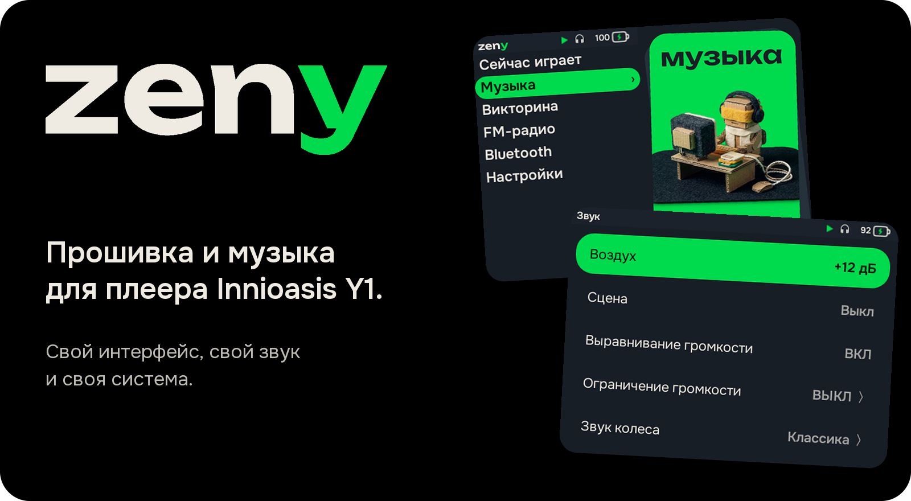
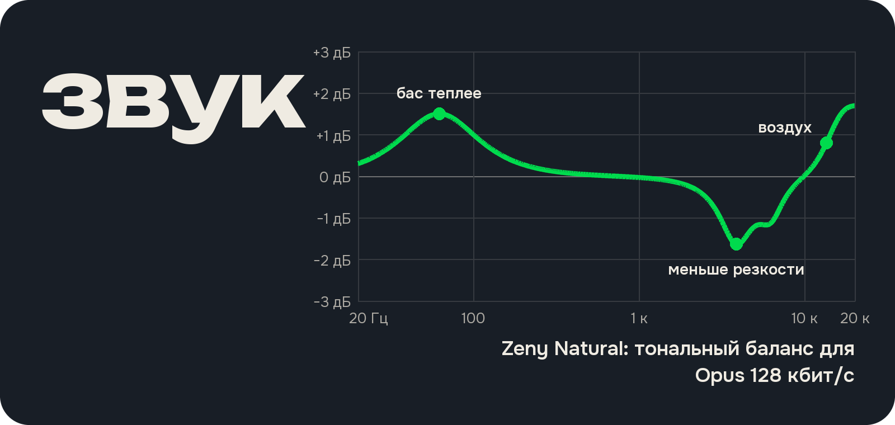

Innioasis Y1 стоит копейки и выглядит как классический iPod с колёсиком, но с завода тормозит, садит батарею в кармане и играет плоско. **zeny** меняет систему, интерфейс и звук, убирая весь лишний мусор.


Крупный русский интерфейс без мелких списков и кривого перевода. В главном меню карточки с роботами, свой экран при подключении кабеля, нормальные предупреждения о батарее. Блокировка снимается тремя нажатиями на центр.



С завода плеер портит звук грубым пересчётом частоты и системными «улучшайзерами». Здесь свой аудиодвижок: по умолчанию играет чисто, без окраски. Хочется поярче: добавьте **Воздух** (от +6 до +18 дБ на верхах). Устают уши от звука прямо в голове: включите **Сцену**, она мягко выносит звук вперёд, как на колонках. Громкость разных альбомов выравнивается сама, а нагрузка на процессор упала в шесть раз. Как это устроено и измерено: в [docs/AUDIO.md](docs/AUDIO.md) и [отчёте лаборатории](tools/audio-lab/REPORT-digital.md).


Из прошивки вычищен фоновый мусор и скрипт, который втихую грел процессор при погашенном экране и жрал половину батареи. Отключён 31 лишний системный пакет, всё обратимо одной командой. Подробности в [docs/SYSTEM.md](docs/SYSTEM.md).


Вместо страшных заводских окон на английском стоят свои экраны подключения к компьютеру, низкого заряда и плохой зарядки. Загрузочная анимация и логотип при включении тоже свои.

## Фишки, которых нет в стоке

- **Сейчас играет:** крупная обложка, спектр в такт музыке, центр ставит лайк, колесо крутит громкость, удержание «вперёд/назад» перематывает с ускорением.
- **Кнопки работают в кармане:** даже на заблокированном плеере колесо меняет громкость, а кнопки переключают треки и ставят паузу. Разблокировать не нужно.
- **Тексты песен (караоке):** положите файл `.lrc` рядом с треком или в тег, и строчка побежит под обложкой в такт голосу. Долгое нажатие на PLAY открывает весь текст и подгонку по времени, если слова спешат или отстают.
- **Угадай мелодию:** игра по вашей медиатеке. Отрывки на 1, 3, 6, 10 или 15 секунд, четыре варианта ответа, три жизни и серия рекордов.
- **Читалка в одно слово (RSVP):** книги `fb2` и `epub` из папки `Books` на карте читаются прямо на маленьком экране со скоростью от 100 до 1000 слов в минуту, с закладками.
- **Щелчок колеса:** пять приятных откликов прямо при прокрутке (Классика, Rockbox, Дерево, Механика или системный).
- **Таймер сна:** выключит музыку через 15 до 90 минут или в конце трека, последние полминуты плавно убавляя звук.
- **Удаление с концами:** удаляете надоевший трек прямо из меню: убираются сам файл, текст и записи во всех плейлистах. Список удалённых со снятием меток есть в «Настройках».

---

## Как прошить плеер с нуля (пошагово)

Подойдёт любой компьютер (Mac, Windows или Linux) и обычный кабель USB-C, который передаёт данные, а не только заряжает. Вся музыка лежит на карте microSD, с ней ничего не случится.

### Шаг 1. Базовая прошивка (делается один раз, 5 минут)

С завода на плеере закрыт доступ к системе. Чтобы его открыть, ставится базовая прошивка через готовую программу с кнопками:

1. Скачайте и откройте **Innioasis Updater** с сайта [innioasis.app](https://innioasis.app) ([прямая ссылка для Mac](https://github.com/y1-community/Innioasis-Updater/releases/latest/download/Innioasis.Updater.for.Mac.dmg)).
2. В списке прошивок выберите **Rockbox-Y1 (Type A)**: она подходит почти ко всем плеерам.
3. Полностью выключите плеер (`Настройки → Выключить`) и выньте кабель.
4. Нажмите **Install** в программе и только после этого воткните кабель в плеер. Подождите пару минут, пока бежит полоска.

> **Если после включения не крутится колесо:** у вас редкая ранняя ревизия плеера. Повторите то же самое, выбрав в списке **Type B**.
> **Если передумаете:** в том же Innioasis Updater нажмите **Original Software → Restore**, и плеер вернётся в заводское состояние.

### Шаг 2. Ставим zeny

Подключите включённый плеер кабелем к компьютеру (на экране плеера **не** нажимайте «Включить USB-накопитель»).

**Вариант А: за 2 минуты без сборки (готовый файл)**

1. Поставьте `adb` (инструмент связи с Android). На Mac откройте «Терминал» и вставьте:
   ```sh
   brew install --cask android-platform-tools
   ```
2. Скачайте этот репозиторий и готовый файл `zeny-y1-*.apk` со страницы выпусков (`Releases` справа на странице репозитория), положите его в `out/zeny-y1.apk` и запустите установку:
   ```sh
   mkdir -p out
   cp ~/Downloads/zeny-y1-*.apk out/zeny-y1.apk
   scripts/deploy-system.sh
   ```
   Плеер сам перезагрузится (первый запуск около 20 секунд) и откроется уже в zeny.

3. Чтобы убрать фоновый жор батареи и отключить лишние заводские программы:
   ```sh
   scripts/debloat.sh
   ```
   *(Вернуть всё как было: `scripts/debloat.sh enable`.)*

**Вариант Б: собрать из исходников самому**

Если хотите менять код или собрать самый свежий коммит (нужны JDK 17, Android SDK 35 и NDK 28):
```sh
echo "sdk.dir=$ANDROID_HOME" > android/local.properties
scripts/build-y1.sh        # соберёт out/zeny-y1.apk
scripts/deploy-system.sh   # поставит на плеер и перезагрузит
scripts/debloat.sh         # отключит фоновый мусор
```

### Шаг 3. Закидываем музыку и книги

Подключите плеер к компьютеру и нажмите на экране **«Включить USB-накопитель»**: на компьютере откроется флешка:

- **Музыка:** кидайте папки в `Music/Исполнитель/Альбом/01 Трек.opus` (понимает Opus, FLAC, Ogg, MP3 и M4A, обложку берёт из файла или из `folder.jpg` рядом, плейлисты `m3u8` из папки `Y1_Playlists`).
- **Книги:** кидайте файлы `.fb2` и `.epub` в папку `Books`.

Когда отключите накопитель, плеер сам быстро подхватит только новые файлы.

---

## Где копать глубже

Если интересны внутренности, замеры и устройство прошивки:

- [docs/AUDIO.md](docs/AUDIO.md) и [tools/audio-lab/REPORT-digital.md](tools/audio-lab/REPORT-digital.md): как устроен аудиодвижок, почему убран эквалайзер и графики цифровых замеров тракта.
- [docs/SYSTEM.md](docs/SYSTEM.md): что именно вычищено из Android, как устроены загрузочная анимация, логотип и патчи системных окон ([tools/systemui](tools/systemui/README.md)).
- [docs/DEVICE.md](docs/DEVICE.md): железо MT6572, таблица разделов памяти, полный бэкап и ручная запись через [tools/mtk](tools/mtk/README.md).
- [android/README.md](android/README.md): архитектура приложения и сборка под эмулятор.

---

## Ограничения и лицензия

- Цифровой тракт проверен тестами (396 тестов приложения, 16 групп DSP-тестов и стенд `tools/audio-lab`), основные экраны обкатаны на живом плеере. Аналоговый выход наушников приборами не измерялся; читалка на огромных книгах и таймер сна «до конца трека» проверены не до конца.
- Бесплатно для личного и некоммерческого использования: свои части под [PolyForm Noncommercial 1.0.0](LICENSE), приложение является форком InniClassic (`android/LICENSE`), шрифты в [NOTICE.md](NOTICE.md). Проект не связан с Apple Inc. и Innioasis. Перед ручной записью разделов делайте бэкап по [docs/DEVICE.md](docs/DEVICE.md).
