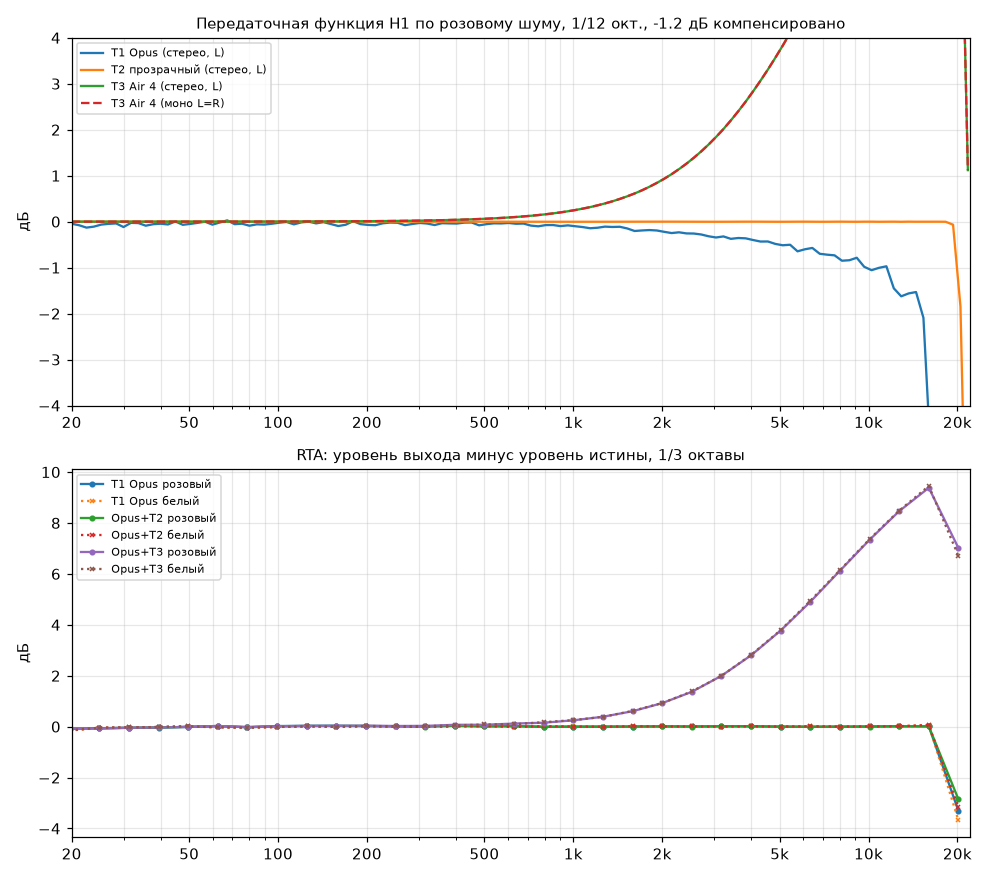
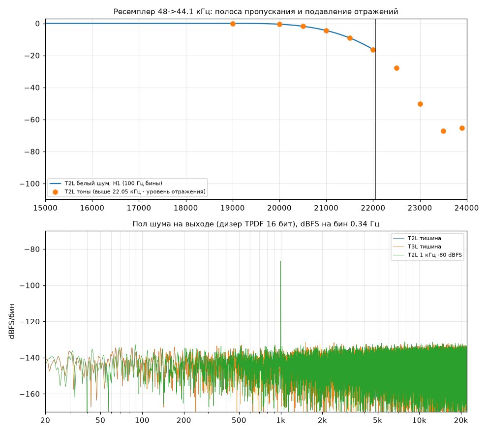
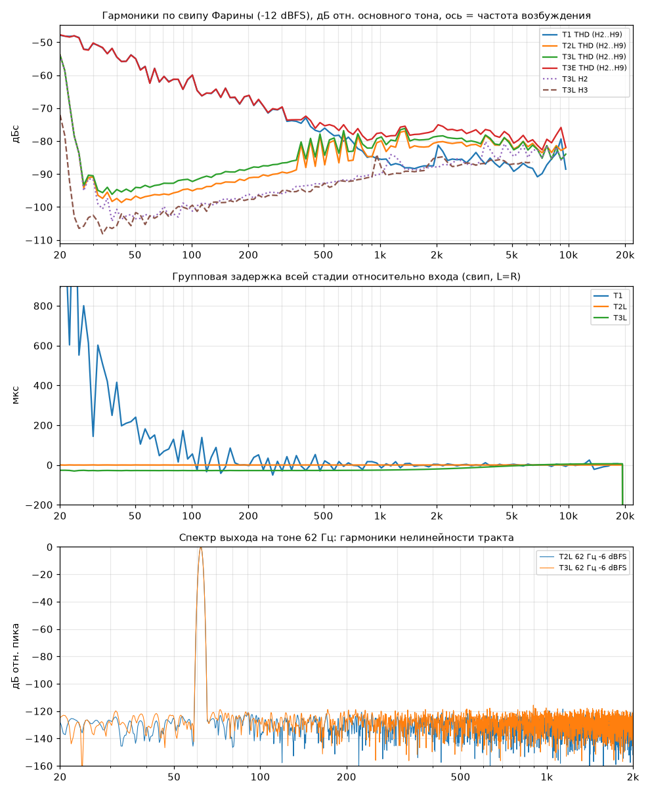
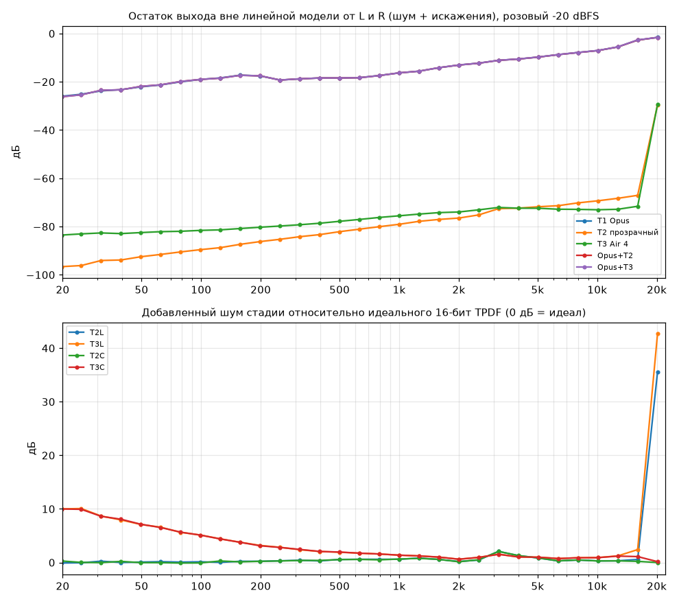
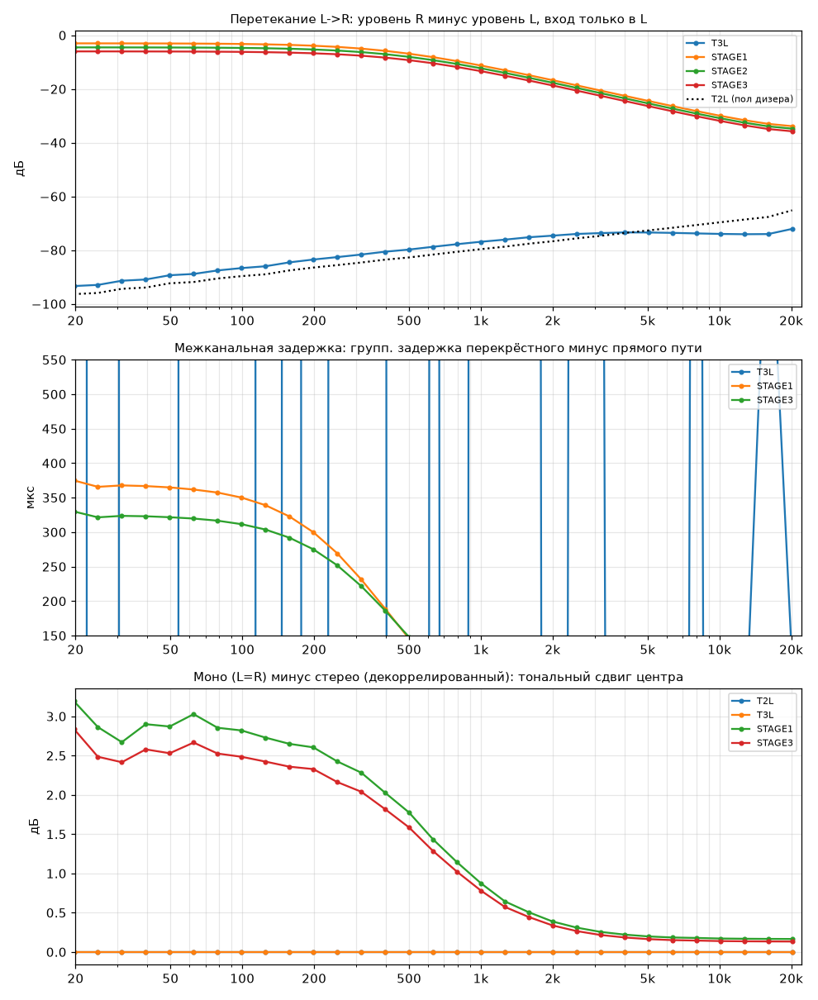
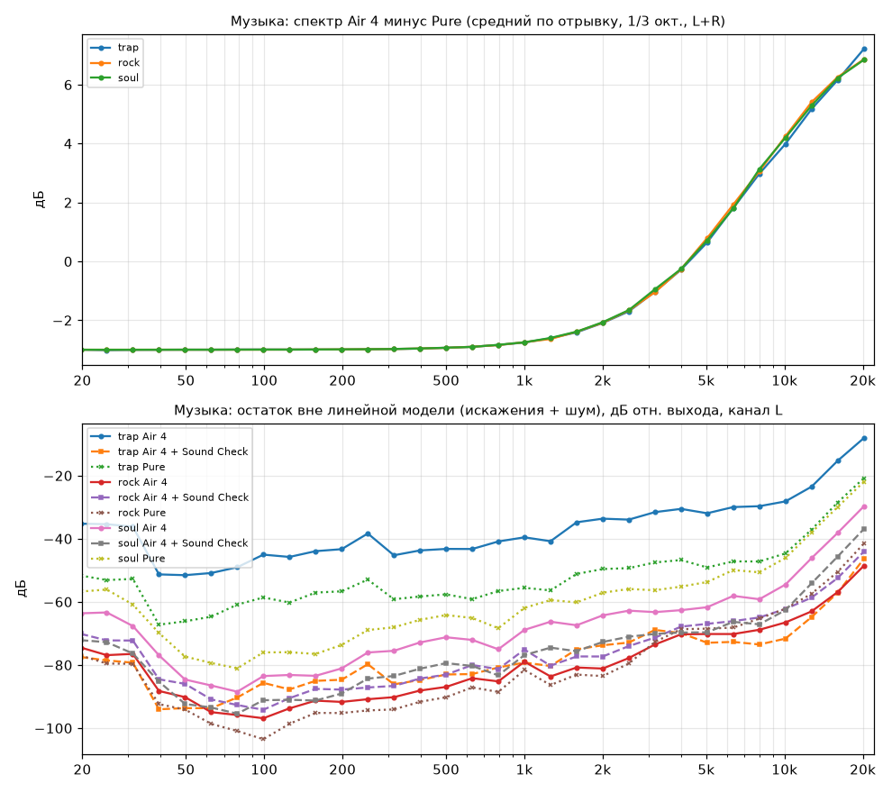

# Цифровой тракт Zeny Y1: измерения (2026-10-19)

Стенд: `tools/audio-lab/run-digital.sh`, все числа лежат в `work/audio-lab/results/summary.json`.
Через тракт прогонялся настоящий `ZenyAudioProcessor`. Числа сняты с нативного ядра (оно работает на устройстве).
Java-ядро сравнивалось с нативным на всех 93 файлах матрицы: максимум 1 LSB, отличаются 0.026 % отсчётов
(63 180 из 243 780 708). Это разный результат округления в дизере, выводы от ядра не зависят.

## Вердикт на один экран

Стадии отсортированы по величине отклонения от прозрачности. Это не оценка того, что звучит лучше.

| # | стадия | что делает с сигналом (числа) |
|---|---|---|
| 1 | **Zeny Natural: АЧХ** | Неравномерность 3.4 дБ п-п (20 Гц–18 кГц, моно). Отклонения: **+2.25 дБ на 63 Гц**, −1.06 дБ на 4 кГц, +1.81 дБ на 16 кГц. Ниже 1 кГц всё приподнято (+0.3 дБ на 500 Гц). На музыке Natural вкл минус выкл: 63 Гц +1.7…+2.3, 4 кГц −1.08, 16 кГц +1.7 дБ. |
| 2 | **Софт-клип на громких мастерах** | Трек trap (true peak +1.61 dBTP, Sound Check выкл): Natural выкл — 1.66 % отсчётов в зоне клипа, ошибка −52 дБ к сигналу. Natural вкл — **4.73 %, ошибка −26 дБ**, срез пиков до 2.4 дБ. При включённом Sound Check (по умолчанию, тег −9.5 дБ) клипа нет. |
| 3 | **Natural: генератор суббаса** | Тон 62 Гц −6 dBFS: **THD+N −39.9 дБ (≈1 %)**, H2 −41.9, H3 −44.3 dBc. Прозрачный DSP на том же тоне: −86 дБ. IMD 60 Гц + 7 кГц: −69.0 дБ (прозрачный −98.6). Утечка в середину: H2 на 1 кГц −3 dBFS = −75.5 dBc (прозрачный < −110). |
| 4 | **Кроссфид 8.5 % (зашит в Natural)** | Перетекание L→R −21.4 дБ на 20–200 Гц, −26.6 дБ на 1 кГц, −47 дБ на 16 кГц. Межканальная задержка **≈480 мкс на НЧ**, 240 мкс выше 5 кГц. Центральный (моно) бас +0.6…+0.74 дБ относительно декоррелированного стерео. Гребенчатый провал −0.35 дБ на 1.25–1.6 кГц. |
| 5 | **Opus 140k (T1)** | Мощность ровная до 20 кГц: ±0.1 дБ по 1/3 окт. от 25 Гц до 16 кГц, −3 дБ на 20.5 кГц. Когерентная часть падает раньше: H1 −1.5 дБ на 16 кГц, −3 дБ на 16.3 кГц. Значит, верх частично заменён шумом той же энергии. На шуме это худший случай для любого кодека. |
| 6 | **Natural: фаза** | Групповая задержка 672 мкс на 62 Гц, 113 мкс на 100 Гц, около 0 выше 1 кГц. Прозрачный DSP: 0 ± 0.6 мкс на всём диапазоне. |
| 7 | **Прозрачный DSP (T2): усиление, ресемплер, дизер** | АЧХ **±0.003 дБ (20 Гц–18 кГц)**, −0.5 дБ на 20 кГц, −3 дБ на 20.8 кГц. Пол дизера −93.74 dBFS (AES17 20–20k), идеал 16-бит TPDF −93.75. THD+N 1 кГц −3 dBFS: −84.0 дБ, предел 16 бит −90.75. Разницу дают спуры ресемплера −88.8 dBc на 2.9 и 4.9 кГц. |

Итог. Прозрачный режим близок к идеальному 16-битному тракту. Есть два отклонения: спуры ресемплера около −89 dBc
и запас −1.2 дБ, которого на громких мастерах не хватает. Всё заметное по величине вносит Natural:
EQ ±2 дБ, нелинейный генератор с 1 % THD на басу и кроссфид. На громких треках без Sound Check Natural
к тому же утраивает работу софт-клипа.

## Метод (коротко)

- **Истина** — WAV 48 кГц float, сид 20261019. Opus кодируется как в библиотеке: `ffmpeg -c:a libopus -b:a 140k -vbr on -application audio`, декод `libopus` во float.
- **Стадии**:
  - T1 — Opus.
  - T2 — DSP с выключенными Natural, кроссфидом, EQ и Sound Check.
  - T3 — Natural вкл, Sound Check выкл, чтобы выделить сам DSP.
  - T3S — Natural + Sound Check с тегом трека, только для музыки.
  - Каждая стадия меряется против своего входа: суффикс `L` — вход без потерь, `C` — вход после Opus. Сквозной результат (истина → Opus → DSP) обозначен `T2E`/`T3E`.
- **48 vs 44.1 кГц**. Эталон приводится к 44.1 кГц идеальным FFT-ресемплингом. Выход DSP не ресемплируется обратно в 48 кГц через `resample_poly 160/147`.
  - **Это отступление от протокола.** Фильтр `resample_poly` даёт собственный спад около 22 кГц и примешал бы его к измерению.
  - Известные −1.2 дБ усиления компенсируются. Выравнивание по взаимной корреляции: у DSP лаг 0, ресемплер работает без задержки.
- **АЧХ** считается по Welch H1 = Pxy/Pxx (окно 65 536, Ханн) и сглаживается до 1/12 и 1/3 октавы. RTA = уровень выхода минус уровень истины по 1/3 октавы.
- **Когерентность**. Вместо одноканальной когерентности используется остаток выхода вне линейной модели от двух входов (L и R). Причина: кроссфид смешивает декоррелированные каналы, и обычная когерентность приняла бы его за шум.
  - Шум стадии сравнивается с идеальным 16-битным TPDF (0 дБ = идеал).
- **Тоны**. Окно Кайзера β = 38. THD+N и N+D считаются в полосе 20 Гц–20 кГц с учётом дизера.
- **Свип Фарины** (−12 dBFS, 20 с) раскладывается на гармонические импульсные характеристики. Выше примерно 1 кГц THD по свипу упирается в шум, поэтому THD на ВЧ взят из ступенчатых синусов.
- Самопроверка `analyze.py --selftest` проходит. Тождественная цепочка даёт 0.000 дБ. Идеальный ресемплинг + 16-бит TPDF даёт АЧХ < 0.01 дБ и шум в пределах 1 дБ от идеала. THD чистого синуса < −200 дБ.

## Критерии прозрачности и результат

### T2 — DSP в прозрачном режиме (вход без потерь, если не указано иное)

| критерий | порог | измерено | |
|---|---|---|---|
| АЧХ 20 Гц–18 кГц | ±0.1 дБ | 0.003 дБ п-п | PASS |
| АЧХ 20 Гц–20 кГц | ±0.1 дБ | 0.066 дБ п-п, на 20 кГц −0.50 дБ | PASS (20 кГц на границе) |
| Гармоники H2..H9 (62 Гц, 1 кГц, 10 кГц) | < −100 dBc | < −110 dBc | PASS |
| THD+N 1 кГц −3 dBFS | < −90 дБ | −84.0 дБ (N+D −88.2 dBFS) | WARN |
| Спуры ресемплера | < −100 dBc | −88.8 dBc на 2.9/4.9 кГц (= ∓f + k·3.9 кГц) | WARN |
| Пол шума (тишина, AES17) | идеал 16 бит ±0.5 дБ | −93.74 dBFS (идеал −93.75), A-взв. −95.8 dBFS, макс. 1 LSB | PASS |
| Шум под сигналом против идеала | < +1 дБ | белый +0…+0.9 дБ, розовый до +2.1 дБ (3.15 кГц) | WARN |
| Линейность: тон −80 dBFS | ±0.1 дБ | −0.008 дБ, гармоники на уровне шума (−46 dBc = пол) | PASS |
| Ошибка обрезания/усечения | нет | нет, дизер корректный | PASS |
| IMD 60 Гц + 7 кГц | < −90 дБ | −98.6 дБ | PASS |
| Перекрёстные помехи | < −80 дБ | на уровне пола дизера (< −85 дБ), L/R симметрия 0.00 дБ | PASS |
| Фаза / групповая задержка | 0 | разброс 0.6 мкс на 40 Гц–16 кГц | PASS |
| Подавление алиасов > 22.05 кГц | > 60 дБ | 22.5 кГц → −27.9; 23 кГц −50.4; 23.5 кГц −67.2; 23.9 кГц −65.2 дБ | WARN (без последствий для библиотеки: после Opus выше 20 кГц сигнала нет, лишний шум в полосе 20 кГц +0.16 дБ) |
| Пики на громком мастере (trap, вход после Opus) | 0 отсчётов в колене | 1.66 % отсчётов > −1.7 dBFS, ошибка −51.8 дБ, срез до 1.1 дБ | WARN (запаса −1.2 дБ не хватает на +1.61 dBTP) |

Ресемплер: −0.5 дБ на 20 кГц, −1.79 на 20.5, −3 дБ на 20.8, −4.46 на 21, −9.06 на 21.5, −16.4 дБ на 22 кГц.
Полоса пропускания ровная до 19 кГц (+0.004 дБ).

### T3 — Zeny Natural (Sound Check выкл)

| критерий | порог | измерено | |
|---|---|---|---|
| АЧХ 20 Гц–18 кГц (моно L=R) | ±0.1 дБ | 3.37 дБ п-п | WARN |
| АЧХ, стерео декоррелированное (прямой путь L) | ±0.1 дБ | 3.15 дБ п-п | WARN |
| THD 62 Гц −6 dBFS | < −90 дБ | −39.9 дБ (H2 −41.9, H3 −44.3, H5 −61.5, H7 −71.3, H9 −78.3 dBc) | WARN |
| THD по свипу 20–200 Гц | < −90 дБ | максимум −41.3; 31.5 Гц −42.3, 62 Гц −45.9, 100 Гц −49.0 | WARN |
| THD+N 1 кГц −3 dBFS | < −90 дБ | −73.1 дБ (H2 −75.5, H3 −77.9 dBc) | WARN |
| IMD 60 Гц + 7 кГц | < −90 дБ | −69.0 дБ | WARN |
| Уровень зависит от уровня | 0 | 62 Гц: +2.49 дБ на тоне −6 dBFS против +2.25 дБ на розовом −20 dBFS | WARN |
| Перекрёстные помехи | < −80 дБ | −21.4 дБ (НЧ) … −47 дБ (16 кГц) — намеренно | WARN |
| Групповая задержка | 0 | 672 мкс на 62 Гц, разброс 752 мкс на 40 Гц–16 кГц | WARN |
| Пол шума (тишина) | идеал | −93.74 dBFS | PASS |

АЧХ T3 по 1/3 октавы (моно розовый, дБ):

| Гц | 20 | 31.5 | 63 | 125 | 250 | 500 | 1k | 2k | 3.15k | 4k | 5k | 6.3k | 8k | 10k | 12.5k | 16k |
|---|---|---|---|---|---|---|---|---|---|---|---|---|---|---|---|---|
| T3 | +1.06 | +1.50 | +2.25 | +1.39 | +0.76 | +0.33 | −0.03 | +0.09 | −0.51 | −1.06 | −0.85 | −0.56 | +0.09 | +0.53 | +1.10 | +1.81 |

### Каналы и кроссфид

Тест: на вход подаётся розовый шум только в L. Перетекание = уровень R минус уровень L, дБ.
Межканальная задержка = ГВЗ перекрёстного пути минус ГВЗ прямого.

| режим | 20–200 Гц | 500 Гц | 1 кГц | 4 кГц | 16 кГц | задержка НЧ / ВЧ | моно минус стерео, НЧ / 1.25–1.6 кГц |
|---|---|---|---|---|---|---|---|
| T2 (выкл) | пол дизера | — | — | — | — | — | 0 / 0 |
| T3 (Natural, 8.5 %) | −21.4 | −23.4 | −26.6 | −33.2 | −47.4 | ≈480 / 240 мкс | +0.62…+0.74 / −0.35 дБ |
| XF1 (15 %) | −16.5 | | | | | ≈478 / 240 мкс | +1.1 / −0.63 дБ |
| XF2 (24 %) | −12.4 | | | | | то же | +1.6 / −1.04 дБ |
| XF3 (33 %) | −9.6 | | | | | то же | +2.0…+2.2 / −1.49 дБ |

L/R симметричны во всех режимах (0.00 дБ).

### T1 — Opus 140k (кодек, справочно)

Opus по построению не прозрачен. Случайный шум с широким спектром — худший случай для любого
перцептивного кодека: маскировка не работает, и кодек заполняет полосы шумом той же энергии. Поэтому
THD+N кодека на тонах не перцептивная метрика. Музыка кодируется заметно лучше, отрывки ниже приведены
только как проверка правдоподобия.

- **Полоса.** Мощность −3 дБ на 20.48 кГц, −20 дБ на 21.7 кГц. По 1/3 октавы ±0.1 дБ на 25 Гц–16 кГц.
- **Когерентная часть.** −0.4 дБ на 8 кГц, −1.48 дБ на 16 кГц, −3.5 дБ на 18 кГц.
- **Остаток к выходу.** Стерео-шум: −20 дБ на НЧ, −2.6 дБ на 18 кГц. Моно: от −28 до −9.8 дБ на 16 кГц.
- **НЧ.** −0.2 дБ на 20 Гц, ГВЗ около 600 мкс на 31.5 Гц (ФВЧ энкодера).
- **Тоны:**

| сигнал | результат |
|---|---|
| 1 кГц −3 dBFS | THD+N −45.2 дБ; это шум у тона (спур −48 dBc на 953 Гц), гармоники < −104 dBc |
| 62 Гц | THD+N −58 дБ, H2 −66, H3 −63 dBc |
| −80 dBFS | уровень −0.12 дБ, H3 −31.8, H5 −27.2 dBc |
| IMD | −82.4 дБ |

- **Тишина.** На выходе цифровой ноль.

## Музыка (3 отрывка по 30 с, правило выбора фиксированное)

| отрывок | true peak | после −1.2 дБ выше −1.7 dBFS | T2C: в колене / ошибка | T3C (Natural): в колене / ошибка / срез | T3S (Natural+SC) |
|---|---|---|---|---|---|
| trap — громкий хип-хоп мастер, тег −9.70 | +1.61 dBTP | 47 852 отсчёта | 1.66 % / −51.8 дБ | **4.73 % / −26.0 дБ / 2.36 дБ** | 0 (пик −8.06 dBFS) |
| rock — рок 1970-х, тег −4.60 | +0.04 dBTP | | 0.003 % / −78.4 дБ | 0.0066 % / −67.3 дБ / 0.35 дБ | 0 (−5.32 dBFS) |
| soul — соул, тег −6.80 | +0.24 dBTP | | 0.056 % / −64.0 дБ | 0.16 % / −48.8 дБ / 0.94 дБ | 0 (−6.77 dBFS) |

Остаток вне линейной модели на 20 / 25 / 31.5 Гц, дБ к выходу, канал L. Это продукты генератора суббаса и клипа:

| отрывок | T2C | T3C | T3S |
|---|---|---|---|
| trap | −51.7 / −53.1 / −52.7 | −19.7 / −21.6 / −20.4 (доминирует клип) | −34.4 / −37.5 / −38.0 |
| rock | −77 / −79.5 / −79.6 | −26.2 / −27.4 / −28.4 | −30.6 / −32.0 / −32.9 |

Разность спектров Natural вкл минус выкл (1/3 октавы) почти одинакова на всех отрывках: 63 Гц +1.7…+2.3 дБ,
4 кГц −1.08 дБ, 16 кГц +1.7 дБ. Спектр отрывков на 16 кГц: −23…−34 дБ относительно полосы 1 кГц.

## Что в Zeny Natural не подтверждается измерениями или сомнительно

- **Генератор суббаса — это нелинейные искажения:** 1 % THD на 62 Гц (H2 −41.9 dBc). Это на 24 дБ больше, чем вносит сам Opus на том же тоне (H2 −66 dBc).
- **Генератор не ограничен полосой суббаса.** H2 на 1 кГц −75.5 dBc против < −110 без Natural: однополюсный ФНЧ 95 Гц даёт на 1 кГц только −20 дБ.
- **Генератор рождает интермодуляцию:** IMD 60 Гц + 7 кГц −69.0 дБ против −98.6 дБ в прозрачном режиме (+30 дБ).
- **Подъём баса зависит от уровня:** на 62 Гц +2.49 дБ при −6 dBFS и +2.25 дБ на розовом шуме −20 dBFS. Часть «EQ» — нелинейная.
- **Natural не оставляет запаса под свой подъём** (+2.3 дБ на 63 Гц, +1.8 дБ на 16 кГц при запасе −1.2 дБ). Без Sound Check на trap доля отсчётов в софт-клипе растёт с 1.66 % до 4.73 %, ошибка — с −52 до −26 дБ к сигналу.
- **Межканальная задержка кроссфида на НЧ ≈480 мкс, а не 250 мкс:** к линии 250 мкс прибавляется ГВЗ однополюсного ФНЧ 700 Гц. Выше 5 кГц задержка 240 мкс.
- **Кроссфид не нормирован.** Центральный (моно) бас становится громче декоррелированного на +0.6…+0.74 дБ. Появляется провал −0.35 дБ на 1.25–1.6 кГц. На ступенях 1–3 эти величины вырастают до +2.2 / −1.5 дБ.
- **Кроссфид поднимает прямой путь** («0.06 HF lift») на +0.2…+0.3 дБ в 500 Гц–2 кГц стерео-сигнала. В перечне полос Natural EQ его нет.
- **Полка +1.7 дБ на 13.5 кГц поднимает полосу, где Opus уже частично заменил сигнал шумом** (когерентная часть −1.5 дБ на 16 кГц при ровной мощности).
- **Фазовый сдвиг на басу:** ГВЗ 672 мкс на 62 Гц против 0 в прозрачном режиме.
- **Кроссфид нельзя выключить:** при Natural его уровень 8.5 % зашит. Измерения T3 всегда содержат и EQ, и генератор, и кроссфид, их вклад виден по отдельности только через XF1..3 и T2.

## Ограничения

- Измерен только цифровой тракт до AudioTrack. ЦАП, усилитель, выходное сопротивление, наушники и микшер Android 4.2 сюда не входят: AudioFlinger на 44.1 кГц 16 бит считается прозрачным, это не проверялось.
- Восприятие не оценивалось. Числа говорят об отклонении от прозрачности, а не о том, что «звучит лучше».
- Шум — худший случай для Opus. Для кодека NMR не считался, а выводы о его слышимости из этих чисел не следуют.
- Три отрывка — проверка правдоподобия, а не статистика по библиотеке из 570 треков. Пиковый запас на других мастерах может отличаться.
- THD по свипу упирается в шум выше примерно 1 кГц, поэтому там взяты ступенчатые синусы.
- Измерения T3 сняты с выключенным Sound Check. С включённым Sound Check (по умолчанию) исчезает клип, а линейные отклонения EQ и генератора остаются, см. T3S.
- Опорный ресемплинг идеальный (FFT), а не `resample_poly 160/147` из протокола: причина описана в разделе «Метод».

## Air (замена Natural)

Разделы выше сняты до правок: там T3 содержит прежний Zeny Natural (генератор суббаса, кроссфид 8.5 %, четыре EQ-фильтра). Профиль Natural удалён. По умолчанию тракт прозрачный (T2). Вместо Natural добавлена опция Air: один фильтр первого порядка, высокая полка с плато 3 / 6 / 9 / 12 дБ (шаги 1..4), геометрическая середина 8 кГц, усиление на постоянной составляющей 1, без изменения баса и без нелинейности. Кроссфид (шаги 1..3) нормирован на 1/(1+mix), на шаге 0 его нет.

В матрице лаборатории T3 теперь означает «Air 4» (+12 дБ), стадии AIR1..AIR4 прогнаны на розовом шуме и тонах, T2S / T3S: Pure / Air 4 с Sound Check. Все числа ниже из `work/audio-lab/results/summary.json` (112 файлов, Java и нативное ядро расходятся не больше чем на 1 LSB).

Ряд шагов Air потом пересчитан: теперь выкл + 5 шагов с плато +6 / +9 / +12 / +15 / +18 дБ (`air_step` 0..5). Форма фильтра и его формулы те же, плато +12 дБ осталось тем же уровнем (бывший шаг 4, теперь шаг 3). Таблицы этого раздела и раздела «Сцена» посчитаны на прежнем ряду 3 / 6 / 9 / 12 дБ и не пересчитывались: лаборатория (`gen_signals.py`, `analyze.py`, `tones.py`) уже настроена на новый ряд, при следующем запуске `run-digital.sh` числа обновятся. Для нового ряда проверки АЧХ, искажений и совпадения Java с нативным ядром выполняет `tools/dsp-test` (отклонение от аналитической формы не больше 0.26 дБ, THD+N −83…−86 дБ, расхождение не больше 1 LSB).

### АЧХ Air против аналитической (розовый моно, относительно входа с учётом −1.2 дБ)

В скобках отклонение измеренного от аналитического значения `10·lg((1+(f/fz)²)/(1+(f/fp)²))`, fz = 8 кГц/√K, fp = 8 кГц·√K.

| шаг (плато) | 1 кГц | 2 кГц | 4 кГц | 5 кГц | 8 кГц | 10 кГц | 12.7 кГц | 16 кГц |
|---|---|---|---|---|---|---|---|---|
| 1 (+3 дБ) | +0.05 (0.00) | +0.19 (+0.01) | +0.62 (+0.02) | +0.88 (+0.02) | +1.54 (+0.04) | +1.88 (+0.04) | +2.19 (+0.04) | +2.42 (+0.03) |
| 2 (+6 дБ) | +0.10 (0.00) | +0.39 (+0.01) | +1.28 (+0.03) | +1.79 (+0.04) | +3.07 (+0.07) | +3.74 (+0.08) | +4.34 (+0.08) | +4.81 (+0.05) |
| 3 (+9 дБ) | +0.16 (0.00) | +0.62 (+0.01) | +1.99 (+0.04) | +2.75 (+0.06) | +4.60 (+0.10) | +5.56 (+0.12) | +6.43 (+0.12) | +7.13 (+0.08) |
| 4 (+12 дБ) | +0.25 (0.00) | +0.91 (+0.02) | +2.79 (+0.05) | +3.77 (+0.07) | +6.12 (+0.12) | +7.33 (+0.15) | +8.45 (+0.15) | +9.37 (+0.11) |

Полоса 20 кГц здесь не показана: она попадает на спад ресемплера (−0.5 дБ на 20 кГц в Pure) и на границу Найквиста, отклонение −1.5…−1.65 дБ в ней вызвано полосой измерения, а не фильтром. Тоны на 20 кГц в harness дают отклонение от аналитической не более −0.17 дБ. Басовые полосы (20–125 Гц) в AIR1..4 отличаются от Pure не больше чем на 0.0002 дБ.

### Искажения и пол (Air против Pure)

| сигнал | Pure (T2) | Air 1 | Air 2 | Air 3 | Air 4 |
|---|---|---|---|---|---|
| THD+N 62 Гц, −6 dBFS, дБ | −86.0 | −85.98 | −86.02 | −86.00 | −86.02 |
| H2 62 Гц, dBc | −119.0 | −118.9 | −117.0 | −116.6 | −117.0 |
| THD+N 1 кГц, −3 dBFS, дБ | −84.0 | −84.05 | −84.03 | −84.08 | −84.10 |
| H2 1 кГц, dBc | −116.6 | −116.8 | −115.7 | −116.4 | −116.7 |
| IMD 60 Гц + 7 кГц, дБ | −98.6 | −97.3 | −98.9 | −99.8 | −101.5 |

Нелинейных добавок нет: гармоники на уровне шума измерения, THD+N совпадает с Pure в пределах 0.1 дБ. IMD различается на уровне шумового пола метода (±3 дБ).

### Пики и мягкий клип (доля отсчётов выше колена −1.7 dBFS)

| мастер (тег Sound Check) | Pure, SC выкл | Air 4, SC выкл | Pure, SC вкл | Air 4, SC вкл |
|---|---|---|---|---|
| trap (−9.7 дБ) | 1.66 % | 3.66 % | 0.00 % | 0.00 % |
| rock (−4.6 дБ) | 0.003 % | 0.009 % | 0.00 % | 0.00 % |
| soul (−6.8 дБ) | 0.056 % | 0.143 % | 0.00 % | 0.00 % |

Правило запаса: при Air 4 на громком мастере с включённым Sound Check (по умолчанию) доля клипа выросла на 0.0 п.п. (порог 0.5 п.п.), поэтому дополнительного запаса в `recomputeStaticGain` нет. Без Sound Check на самом громком мастере (trap) Air 4 добавляет 2.0 п.п. клипа; в этом режиме запас не вводился. Клип на розовом шуме отдельно не считался.

### Что не изменилось

| показатель | значение |
|---|---|
| T2 (Pure): размах АЧХ 20 Гц – 18 кГц | 0.002 дБ |
| T2: THD+N 62 Гц / 1 кГц, IMD | −86.0 / −84.0 дБ, −98.6 дБ |
| T2: перетекание L→R, 20 Гц / 1 кГц / 16 кГц | −96.4 / −79.6 / −67.6 дБ |
| XF1 / XF2 / XF3: перетекание L→R, 20 Гц | −16.5 / −12.4 / −9.6 дБ |
| XF1 / XF2 / XF3: перетекание L→R, 1 кГц / 16 кГц (XF1) | −21.6 / −42.5 дБ |
| XF1 / XF2 / XF3: усиление центрального шума, 20–125 Гц | −0.00…−0.07 / −0.00…−0.11 / −0.00…−0.14 дБ |

## Сцена (замена кроссфида)

Старый кроссфид Бауэра (15 / 24 / 33 %, нормировка 1/(1+mix), поправка +0.06·ВЧ, целочисленная линия задержки 250 мкс поверх ФНЧ) заменён на «Сцену»: `out_L = in_L − G·LP(in_L) + G·LP(in_R)`, `G = 1/(1+10^(feed/20))`, LP — однополюсный ФНЧ 700 Гц с единичным усилением на постоянной составляющей. Шаги: 1 = подача 3 дБ, 2 = 4.5 дБ, 3 = 6 дБ. Одновременно «Воздух» получил статический срез запаса 0.25 дБ на дБ плато (−0.75 дБ на шаг, −3 дБ на шаге 4). Стадии лаборатории `XF1..3` переименованы в `STAGE1..3`; в матрице T3 = Air 4 с учётом среза. Числа ниже из `work/audio-lab/results/summary.json` (112 файлов, Java и нативное ядро расходятся не больше чем на 1 LSB) и из `tools/dsp-test/run.sh`.

Отдельной линии задержки в «Сцене» нет. Всепропускающий фильтр X сделал бы моно неплоским (ручной расчёт, не измерение: порядка −0.2…−0.4 дБ на 400 Гц уже при 50–100 мкс добавки), поэтому выбрана плоская моно-характеристика, а не точность задержки.

### Моно (L=R) и центр

| показатель | Старый кроссфид (шаги 1/2/3) | Сцена (шаги 1/2/3) |
|---|---|---|
| Центральный бас 100 Гц до нормировки | +1.2 / +1.9 / +2.5 дБ (расчёт 20·lg(1+mix)) | 0.000 дБ |
| Центр на 10 кГц (модель из исследования) | −1.3 / −2.0 / −2.6 дБ | −0.001 дБ (уровень пола T2) |
| Моно, максимум отклонения 20 Гц – 16 кГц, лаборатория (розовый моно) | −0.0…−0.14 дБ на НЧ после нормировки, до −2.6 на ВЧ | −0.0023 дБ на 1 кГц (то же число у T2) |
| Моно на шуме и 12 частотах (Harness), шаги 1/2/3 | не измерялось | побитово равно шагу 0, отклонение 0.0000 дБ |

### Разделение каналов (вход только слева)

Harness, тоны, измерено / формула, дБ; разделение = L→L − L→R.

| шаг (подача) | 100 Гц L→L | 100 Гц L→R | разделение 100 Гц | 700 Гц L→R | 3 кГц L→R | 10 кГц L→L | 10 кГц L→R |
|---|---|---|---|---|---|---|---|
| 1 (3 дБ) | −4.50 / −4.50 | −7.74 / −7.74 | 3.24 | −10.66 / −10.66 | −20.47 / −20.46 | −0.18 / −0.18 | −30.14 / −30.14 |
| 2 (4.5 дБ) | −3.93 / −3.93 | −8.65 / −8.65 | 4.71 | −11.57 / −11.57 | −21.38 / −21.37 | −0.16 / −0.16 | −31.05 / −31.05 |
| 3 (6 дБ) | −3.43 / −3.43 | −9.62 / −9.62 | 6.19 | −12.54 / −12.54 | −22.35 / −22.34 | −0.14 / −0.14 | −32.02 / −32.02 |

Разделение на 100 Гц равно подаче в пределах ±0.3 дБ (получено +0.24 / +0.21 / +0.19 дБ, разница с подачей объясняется фазой на 100 Гц). Максимум отклонения измерения от формулы 0.003 дБ. Утечка в R на 10 кГц ниже −30 дБ относительно входа (−30.14 / −31.05 / −32.02); относительно L→L на шаге 1 это −29.96 дБ, то есть при определении «от прямого пути» шаг 1 не дотягивает до порога −30 дБ на 0.04 дБ.

Перетекание L→R по лаборатории (розовый шум только в L, уровень R минус уровень L), дБ:

| стадия | 20 Гц | 125 Гц | 1 кГц | 10 кГц | 16 кГц |
|---|---|---|---|---|---|
| Старый кроссфид 15 % (XF1) | −16.5 | −16.6 | −21.6 | −39.5 | −42.5 |
| Сцена 1 | −3.0 | −3.4 | −11.3 | −30.0 | −33.0 |
| Сцена 2 | −4.5 | −4.8 | −12.3 | −30.9 | −33.9 |
| Сцена 3 | −6.0 | −6.3 | −13.4 | −31.9 | −34.9 |
| T2 (Pure) | −96.4 | −89.0 | −79.6 | −69.6 | −67.6 |

### Межуншная задержка (перекрёстный путь минус прямой), мкс

Harness, фаза с реального процессора на f±10 Гц, формула совпадает точно:

| Гц | шаг 1 | шаг 2 | шаг 3 | цель |
|---|---|---|---|---|
| 100 | 350 | 329 | 312 | 250–320 |
| 200 | 300 | 287 | 275 | 250–320 |
| 400 | 188 | 187 | 186 | 250–320 |
| 700 | 90 | 93 | 95 | |

Абсолютные групповые задержки на 100 Гц: прямой −138 / −117 / −99 мкс, перекрёстный +213 мкс (задержка самого ФНЧ). Лаборатория по полосам даёт то же: 125 Гц 339 / 320 / 304, 250 Гц 269 / 260 / 252 мкс; старый кроссфид давал 487 → 460 мкс на 20 Гц – 1 кГц. Цель 250–320 мкс выполнена на 200 Гц для всех шагов и на 100 Гц для шагов 2–3 (шаг 1: 350 мкс, чуть выше, но в пределах 380 мкс по Куну); на 400 Гц получено 188 мкс, ниже цели. Поднять её можно только фазовым звеном ценой неплоского моно, поэтому оставлено так.

### Линейность и согласие с независимой формулой

| проверка | результат |
|---|---|
| THD+N, левый канал, 62 Гц / 1 кГц, шаги 1–3 | −81.4…−82.4 дБ (порог −80, предел дизера 16 бит) |
| −20 дБ на входе → −20 дБ на выходе, прямой и перекрёстный путь | отклонение 0.000 дБ |
| numpy-модель из формул (`analyze.py: section_ref`) против измерения по полосам 20 Гц – 16 кГц, Сцена 1/2/3, прямой и перекрёстный путь | не больше 0.002 дБ (на 1 кГц) |
| «Воздух» 1/2/3/4 против аналогового прототипа | не больше 0.045 / 0.083 / 0.118 / 0.148 дБ (на 10–12.7 кГц) |

### «Воздух»: срез запаса

Теперь «Воздух» 4 в полосе 1 кГц даёт +0.25 дБ формы и −3.00 дБ среза: АЧХ относительно Pure на 1 / 4 / 8 / 16 кГц на шаге 4: −2.75 / −0.21 / +3.12 / +6.37 дБ (лабораторные числа раздела «Air (замена Natural)» выше дают форму без среза: +0.25 / +2.79 / +6.12 / +9.37). Доля отсчётов выше колена −1.7 dBFS на самом громком мастере (trap), Sound Check выкл.: Pure 1.66 %, Air 4 без среза 3.66 % (старый прогон), Air 4 со срезом 0.39 %; rock 0.003 % → 0.000 %; soul 0.056 % → 0.0003 %. Со включённым Sound Check везде 0.00 %. THD+N «Воздуха» остаётся −83…−85 дБ, IMD −96…−98 дБ.

## Уборка (фаза 2)

Из плеера удалены 10-полосный программный эквалайзер (пресеты, профили, графический редактор), эффекты MediaTek (Equalizer, BassBoost, Virtualizer) и мёртвые `Y1EqAudioProcessor` / `Y1CrossfeedAudioProcessor`. Цепочка DSP теперь: усиление / AGC / Sound Check → Air → Сцена → ресемплер → дизеринг → мягкий клип. В лаборатории EQ-цепочек не было, матрица (T2, T3, AIR1..4, STAGE1..3, T2S, T3S) не менялась.

Прогон `run-digital.sh` после уборки: exit 0, 112 файлов, расхождение Java и нативного ядра не больше 1 LSB. Размах АЧХ Pure (T2, 19.7 Гц – 16 кГц) 0.002 дБ, THD+N 62 Гц −86.0 дБ, IMD −98.6 дБ: числа прозрачного тракта и разделов Air и Сцена выше не изменились, потому что их цепочки удалённый код не затрагивал.

## Откат среза Air

Статический срез запаса у «Воздуха» (−0.75 дБ на шаг) убран по решению владельца: плеер не должен становиться тише от включения тембра, а мягкий клип на громких пиках приемлем. Статическое усиление снова −1.2 дБ на всех шагах. Числа раздела «Air (замена Natural)» (+0.25 / +2.79 / +6.12 / +9.37 дБ на 1 / 4 / 8 / 16 кГц на шаге 4) снова описывают реальный тракт; раздел «Воздух: срез запаса» выше описывает снятый вариант. Из исследования библиотеки (60 треков, Sound Check выкл.): Air 4 без среза задевает колено мягкого клипа выше 1 % отсчётов у 52 % треков (Pure 20 %); со включённым Sound Check клипа нет.
